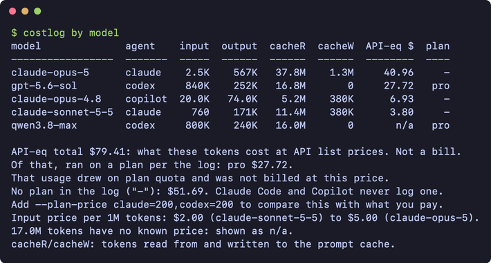

# costlog

What your coding-agent usage would cost on the API, and whether your subscription paid for itself. For Codex it also reads the plan and the quota windows straight from the logs. It reads local files only and makes no network calls.

Reads Claude Code, Codex CLI, GitHub Copilot CLI and Cursor data today.



## Why not ccusage or tokscale

Both are good, read more agents, and scan faster the first time. costlog is narrower and does five things they did not when compared in October 2026 (ccusage 20.0.28, tokscale 4.18.0):

- **It tells you what a plan was worth.** Give it what you pay, `--plan-price claude=200,codex=200`, and it prints the API-equivalent cost of each agent against that price for the period. This works for every agent it prices.
- **For Codex, it reads the plan from the log.** Codex records the plan each session ran on, so costlog shows how much of the total drew on plan quota. Claude Code and Copilot CLI do not record a plan, so this part is Codex only.
- **It prices Codex Fast mode per request for every model that publishes a rate.** ccusage applies no Fast multiplier to three current models ([ccusage/ccusage#1852](https://github.com/ccusage/ccusage/issues/1852)).
- **It shows Codex quota windows without a network call**, for every account that ran on the machine. `ccusage blocks` covers Claude Code only, and `tokscale usage` needs the network and reports the signed-in account.
- **It labels what it cannot know.** A model with no price is `n/a`, never `$0`. Cursor's partial token data is never priced.

If you want the widest agent coverage or the fastest cold scan, use those tools.

## Run

```bash
npx costlog
```

Requires Node 20 or newer. There is nothing else to install: the CLI has no dependencies. Reading Cursor's database needs Node 22.5 or newer; on older versions Cursor is skipped and `costlog doctor` says so.

No agent logs on this machine? From a checkout, every command also runs on made-up data:

```bash
git clone https://github.com/lyhao223/costlog && cd costlog
node scripts/demo.mjs
node scripts/demo.mjs windows
```

Running from a checkout needs Node 22.18 or newer, which executes the TypeScript sources directly (`node src/cli.ts`).

## Commands

| Command | Shows |
|---|---|
| `costlog` | tokens and cost per day and agent, last 30 days |
| `costlog by model` | the same totals per model, most expensive first |
| `costlog by project` | per working directory |
| `costlog windows` | quota windows recorded in the logs |
| `costlog doctor` | which log directories were found and how much was parsed |
| `costlog statusline` | one line for a prompt or status bar: today's API-equivalent cost and any open quota window |

Options: `--since YYYY-MM-DD`, `--until YYYY-MM-DD`, `--plan-price LIST`, `--json`, `--pricing-file PATH`, `--no-cache`, and `--all` for `windows`.

Sessions older than 30 days are outside the default range; pass `--since` to include them. Exit code 3 means no agent logs were found.

## Output

`costlog --plan-price claude=100,codex=200`, on the demo data:

```
day         agent    input  output  cacheR  cacheW  API-eq $  plan
----------  -------  -----  ------  ------  ------  --------  ----
2026-10-04  claude     400   90.0K    6.0M    200K      5.15     -
2026-10-04  codex     200K   60.0K    4.0M       0      1.98   pro
2026-10-05  claude     480    108K    7.2M    240K      7.35     -
2026-10-05  codex     240K   72.0K    4.8M       0      5.94   pro
...

API-eq total $79.41: what these tokens cost at API list prices. Not a bill.
Of that, ran on a plan per the log: pro $27.72.
That usage drew on plan quota and was not billed at this price.
No plan in the log ("-"): $51.69. Claude Code and Copilot never log one.
claude: $44.76 API-eq, $100.00 paid (30d at $100.00/mo): 45%
codex: $27.72 API-eq, $200.00 paid (30d at $200.00/mo): 14%
Cells are rounded to the cent; totals are exact, so they can differ by a cent.
Plan lines: API-eq over what you paid, assuming the plan ran the whole period.
A day can mix models with different prices: `costlog by model` splits them.
17.0M tokens have no known price: run `costlog by model` to see which.
cacheR/cacheW: tokens read from and written to the prompt cache.
Prices: LiteLLM, 2026-10-10.
3 files, 57 requests, 0 unreadable lines.
```

`costlog windows`:

```
agent  account   plan  window  used   resets UTC  age
-----  --------  ----  ------  ----  -----------  ---
codex  acct-dem  pro       5h   62%  10-10 19:52  57m
codex  acct-dem  pro       7d   31%  10-14 16:52  57m

Rows are snapshots from each account's last session, not live quota.
Claude Code: no limit was hit in this period, and its logs record nothing else.
```

## What the numbers mean

| Column | Meaning |
|---|---|
| `input` | prompt tokens that were not served from the cache |
| `output` | tokens the model wrote, including reasoning |
| `cacheR`, `cacheW` | tokens read from and written to the prompt cache |
| `API-eq $` | list price of those tokens, computed per request. Cells are rounded to the cent and totals are exact, so a column can differ from its total by a cent; the footer says so when it does |
| `plan` | the subscription the log recorded for that usage, copied as written (`pro`, `prolite`, `free`) |

**API-eq $** applies the long-context tier when a prompt crosses the model's threshold, the priority (Fast mode) rate when the log says the request used it, and the one-hour cache-write rate for Claude. It is a comparison figure. If you are on a subscription, you did not pay it. A day row can mix cheap and expensive models; `costlog by model` shows which.

**Plan value.** `--plan-price claude=200` adds a line such as `claude: $747.67 API-eq, $200.00 paid (30d at $200.00/mo): 3.7x`. The figure at the end is the API-equivalent cost divided by what you paid: `3.7x` means the tokens would have cost 3.7 times the plan price, and a percentage means you used less than you paid for. Three things to know:

- The monthly price is prorated to the report period, taking a month as 30 days, and assumes the plan was active for all of it. No log records a billing cycle, so pick `--since` and `--until` to match the time you were subscribed.
- `codex:pro=200` limits the comparison to usage the log ties to that plan. Use it when one agent ran on more than one plan; costlog tells you when that happened.
- It compares list price with what you pay. It does not say how close you are to a limit. Agents are `claude`, `codex` and `copilot`; Copilot bills by premium request, so its figure is a rough guide.

**plan** `-` means the log does not record one. That is always the case for Claude Code and Copilot CLI, so it is not an error.

**n/a** means the model has no known price. costlog reports those tokens separately and never counts them as $0. Add prices with `--pricing-file`:

```json
{ "qwen3.8-max": { "input_cost_per_token": 0.0000012, "output_cost_per_token": 0.000006 } }
```

A malformed price file stops the run with an error. Built-in prices are a dated snapshot of LiteLLM's table; the footer prints its date.

## Claude Code plugin

The repository is also a Claude Code plugin. It runs the npm package through `npx`.

```
/plugin marketplace add lyhao223/costlog
/plugin install costlog@costlog
```

It adds two things:

- `/costlog:report` runs costlog and has Claude summarise the result. It takes the same arguments, for example `/costlog:report by model --plan-price claude=200`.
- A hook that rewrites `~/.cache/costlog/statusline.txt` after a turn, at most once a minute, in the background.

A plugin cannot set the status line for you. To show the cached line, add this to `~/.claude/settings.json`:

```json
{ "statusLine": { "type": "command", "command": "cat ~/.cache/costlog/statusline.txt 2>/dev/null" } }
```

The status line only reads that file, so it never slows Claude Code down. It can be up to a minute behind.

## What each log can and cannot tell you

| Agent | Read from | Tokens | Plan | Quota window |
|---|---|---|---|---|
| Claude Code | `~/.claude/projects/**/*.jsonl` | per request | not recorded | only the moment a limit was hit, with its reset time |
| Codex CLI | `~/.codex/sessions`, `~/.codex/archived_sessions` | per request | recorded | percent used and reset time at the last session |
| Copilot CLI | `~/.copilot/session-state/*/events.jsonl` | per session segment, written at shutdown | not recorded | not recorded |
| Cursor | `state.vscdb` in Cursor's global storage | a minority of responses | not recorded | not recorded |

Limits that follow from this:

- Quota windows are snapshots from the last local session, not live values. Which windows appear (5 hours, 7 days, 30 days) depends on the plan. Windows that have rolled over since are hidden unless none is open; `--all` lists them, marked `(reset)`.
- Codex records the account id from CLI 0.159. Older sessions show `-`, so two rows with the same plan may be one account.
- A Copilot session that is still open, or that crashed, reports no tokens.
- A Codex session that spans the 0.153 log-format change counts only its newer part.
- Cursor keeps usage and billing on its servers. The local database has token counts for a small share of responses (about 5% on the machine this was built on), so costlog counts responses, shows the tokens it finds, and never prices them. Responses are dated by the start of their conversation. Only the macOS path has been checked against a real database.

`CLAUDE_CONFIG_DIR`, `CODEX_HOME`, `COPILOT_HOME` and `CURSOR_STATE_DB` override the default locations.

Gemini CLI is not supported. Google no longer serves it for personal accounts, so no real log was available to build and check a reader against. See [docs/findings.md](docs/findings.md).

## Privacy

- costlog makes no network calls. `test/trust.test.ts` runs every command with sockets, DNS and `fetch` disabled.
- It reads token counts, model names, timestamps, session ids and working directories. The same test checks that prompt and response text reaches neither the output nor the cache.
- Parsed results are cached in `~/.cache/costlog/index.json`. Delete it at any time.
- Prices ship in `data/pricing.json`. `scripts/sync-pricing.mjs` refreshes that file from LiteLLM and is the only code in the repository that touches the network. The CLI never runs it.

## JSON output

`--json` output carries `schemaVersion: 1`. Field names are pinned by `test/cli.test.ts`; a breaking change bumps the version.

```bash
node src/cli.ts by model --json --since 2026-09-01 --until 2026-09-30
```

## Accuracy

On one month of real logs, token totals are within 0.25% of ccusage 20.0.28 for Claude Code and 0.04% for Codex. Cost is within 0.1% for Claude Code. For Codex it matches to the cent on the models where both tools apply the same Fast-mode rule, and differs on three models where ccusage applies none ([ccusage/ccusage#1852](https://github.com/ccusage/ccusage/issues/1852)).

## Adding an agent

See [CONTRIBUTING.md](CONTRIBUTING.md) for the full steps.


An adapter is one file in `src/adapters/` that implements `Adapter` from `src/types.ts`: `roots()`, `locate()` and `parse()`. It returns `UsageEvent` objects and never computes money. Add a fixture made with `scripts/anonymize.mjs`, which redacts every string outside a short allowlist and refuses to write if input text survives.

```bash
node scripts/anonymize.mjs path/to/session.jsonl fixtures/<agent>/<case>.jsonl
npm test
```

## Licence

MIT. See [LICENSE](LICENSE).
